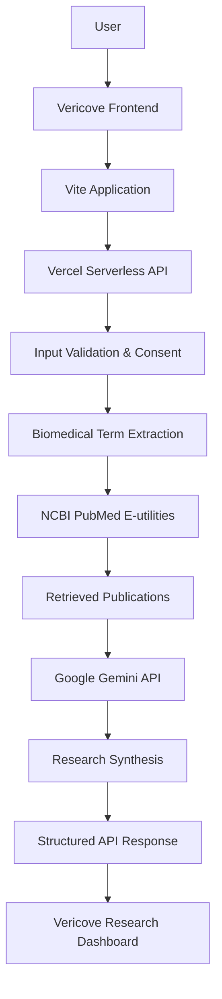

# 🌸 Vericove
### Women's Healthcare. Informed by Research. Strengthened by Community.

<p align="center">
  <strong>An AI-powered women's healthcare platform bringing together intelligent symptom insights, biomedical research, healthcare discovery, and supportive communities.</strong>
</p>

<p align="center">
  <a href="https://vericove-eta.vercel.app/">
    
  </a>
  
  
  
  
  
</p>

---

## ✨ Overview

Women's health information is often fragmented across medical resources, personal experiences, and online communities.

**Vericove** aims to bring these elements together in one accessible digital space.

It combines an interactive women's health workspace with AI-assisted research exploration, biomedical literature retrieval, healthcare discovery, and a community experience designed to encourage informed conversations.

Rather than replacing healthcare professionals, Vericove focuses on helping users explore health-related information and prepare more meaningful questions for professional consultations.

## 🚀 Key Features

### 🧠 AI Symptom Intelligence

Explore symptom-related biomedical research through an integrated AI research workflow.

- Describe symptoms, duration, and severity.
- Retrieve relevant biomedical publications from **PubMed**.
- Use **Google Gemini** to synthesize educational insights.
- Explore biological context and relevant research findings.
- Generate questions to discuss with healthcare professionals.
- Display study limitations and research context.
- Include medical safety boundaries and user consent.

### 🔬 Biomedical Research Discovery

- Search biomedical literature using PubMed E-utilities.
- Retrieve publication metadata and available abstracts.
- Display publication titles, authors, dates, and source links.
- Connect AI-generated explanations to retrieved research.
- Distinguish literature retrieval from individualized medical conclusions.

### 💬 Vericove Community

A dedicated community experience for sharing perspectives and discovering supportive conversations.

- Community feeds with For You and Following views.
- Stories and image-led content discovery.
- Topic-based communities.
- Post creation, discussions, polls, and replies.
- Likes, saves, sharing, and community interactions.
- Search and category-based discovery.

### 🩺 Personal Health Workspace

- Symptom journal and health entries.
- Health timeline and records.
- Treatment notes.
- AI Symptom Intelligence workspace.
- Consultation preparation and summary previews.

### 👩‍⚕️ Healthcare Discovery

- Healthcare professional directory interface.
- Doctor and researcher profile previews.
- Specialty-based discovery.
- Patient-experience and review interface.
- Professional verification workflow previews.

### 🎨 Responsive User Experience

- Clean healthcare-inspired interface.
- Custom purple-themed design system.
- Responsive desktop and mobile navigation.
- Interactive dashboards and workspace layouts.
- Dedicated community application interface.

---

## 🏗️ System Architecture

Vericove uses a vanilla JavaScript frontend with Vite and serverless API functions for AI-powered research workflows.



### AI Research Workflow

1. The user submits symptom information after accepting the research-sharing disclosure.
2. The backend validates the request and consent.
3. Relevant biomedical search terms are extracted.
4. PubMed retrieves matching publications and available abstracts.
5. Gemini generates educational research synthesis grounded in retrieved literature.
6. The frontend presents biological context, research findings, consultation questions, and limitations.

**Important:** PubMed retrieval happens before AI synthesis so that the research output can be grounded in retrieved publications rather than invented citations.

---

## 🛠️ Technology Stack

| Category | Technologies |
|---|---|
| Frontend | HTML5, CSS3, JavaScript (ES6+) |
| Frontend tooling | Vite |
| Backend | Vercel Serverless Functions, Node.js |
| AI integration | Google Gemini API |
| AI SDK | `@google/genai` |
| Biomedical research | NCBI PubMed E-utilities |
| XML processing | fast-xml-parser |
| Deployment | Vercel |
| Version control | Git & GitHub |

---

## 📂 Project Structure

```text
Vericove/
│
├── api/
│   ├── lib/
│   │   ├── gemini.js
│   │   └── pubmed.js
│   └── symptom-intelligence.js
│
├── assets/
├── public/
│   └── assets/
│
├── src/
│   ├── app.js
│   ├── core.js
│   ├── navigation.js
│   ├── views.js
│   ├── interactions.js
│   └── community.js
│
├── docs/
├── index.html
├── styles.css
├── server.mjs
├── package.json
├── package-lock.json
├── .env.example
└── README.md
```

---

## ⚙️ Getting Started

### Prerequisites

Make sure you have installed:

- [Node.js](https://nodejs.org/) — 20.19+ or 22.12+
- npm
- [Git](https://git-scm.com/)

### 1. Clone the repository

```bash
git clone https://github.com/C-Kendhe/Vericove.git
```

### 2. Navigate to the project

```bash
cd Vericove
```

### 3. Install dependencies

```bash
npm install
```

### 4. Configure environment variables

Create a `.env.local` file in the project root.

```env
GEMINI_API_KEY=your_gemini_api_key
GEMINI_MODEL=gemini-3.8-flash

NCBI_EMAIL=your_email@example.com
NCBI_TOOL=vericove_symptom_intelligence

# Optional
NCBI_API_KEY=your_ncbi_api_key
```

**Environment variable information:**

| Variable | Purpose |
|---|---|
| `GEMINI_API_KEY` | Google Gemini API authentication |
| `GEMINI_MODEL` | Gemini model identifier |
| `NCBI_EMAIL` | Required NCBI developer contact email |
| `NCBI_TOOL` | Application identifier for NCBI requests |
| `NCBI_API_KEY` | Optional NCBI API key for higher request limits |

Never commit `.env.local` or expose API keys in frontend code.

### 5. Run the application

For frontend-only development:

```bash
npm run dev
```

For the complete application, including Vercel serverless API functions:

```bash
npx vercel dev
```

Open:

```text
http://localhost:3000
```

### 6. Create a production build

```bash
npm run build
```

---

## 🔐 Privacy, Safety & Prototype Limitations

Vericove is an evolving prototype and is not currently a production-ready medical platform.

- AI-generated information is educational and is not a medical diagnosis.
- Research matches do not establish that a publication applies to an individual.
- AI-generated explanations may be incomplete or inaccurate.
- The community and healthcare discovery experiences include demonstration content and interface previews.
- Authentication, data storage, and professional verification are not equivalent to production-grade healthcare infrastructure.
- Do not submit real health information or personal medical records to the current prototype.
- Free-tier Gemini API usage may be subject to Google's data-use terms. Use fictional data for development and testing.

Always consult a qualified healthcare professional for medical concerns.


## 🌐 Live Project

**Explore Vericove:** [https://vericove-eta.vercel.app/](https://vericove-eta.vercel.app/)

**Source Code:** [https://github.com/C-Kendhe/Vericove](https://github.com/C-Kendhe/Vericove)

---

## 🤝 Contributing

Contributions, suggestions, and ideas are welcome!

1. Fork the repository.
2. Create a feature branch.
3. Make your changes.
4. Commit your changes.
5. Open a Pull Request.

For major changes, open an issue first to discuss what you would like to improve.


<p align="center">
  <strong>Vericove — Because better health conversations start with better information.</strong>
  <br><br>
  If you like this project, consider giving it a ⭐ on GitHub!
</p>
